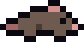
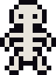
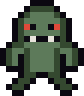
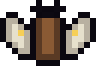
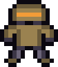
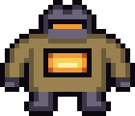

# Enemies of Last Lantern

Every enemy and boss in the game, in the order you meet them: 23 enemies and 5 bosses across 5 biomes. Data comes from `godot/data/` (mirrors of `js/data.js`); sprites are the first animation frame from `godot/assets/sprites/`, scaled ×6 without smoothing.

Stats are the base values at depth 1. Health and damage grow with depth and with Ardor; elites get extra health (see Elite champions). Speeds are in pixels per second, distances in pixels (a tile is 16 px).

A printable version with the same content is [enemies.pdf](enemies.pdf).

## The Crypts

<table>
<tr><td align="center" width="230"></td><td>

<b>1. Crypt Rat</b> · <i>Chaser</i>
<table><tr><th>Health</th><th>Damage</th><th>Speed</th><th>Radius</th><th>XP</th></tr><tr><td>14</td><td>8</td><td>74</td><td>5</td><td>2</td></tr></table>
<b>Traits:</b> — 
<b>Found in:</b> The Crypts, The Fungal Caves 

Runs at you along the room's paths in bursts: it moves for 0.85 s out of every 1.2 s.

</td></tr>
<tr><td align="center" width="230"></td><td>

<b>2. Bat</b> · <i>Erratic</i>
<table><tr><th>Health</th><th>Damage</th><th>Speed</th><th>Radius</th><th>XP</th></tr><tr><td>10</td><td>7</td><td>62</td><td>5</td><td>2</td></tr></table>
<b>Traits:</b> flying 
<b>Found in:</b> The Crypts, The Fungal Caves 

Zigzags toward you with random jitter. Flies over obstacles.

</td></tr>
<tr><td align="center" width="230"></td><td>

<b>3. Skeleton</b> · <i>Shooter</i>
<table><tr><th>Health</th><th>Damage</th><th>Speed</th><th>Radius</th><th>XP</th></tr><tr><td>28</td><td>10</td><td>30</td><td>6</td><td>4</td></tr></table>
<b>Traits:</b> — 
<b>Found in:</b> The Crypts, The Fungal Caves 

Walks toward you and backs away when you are closer than 70 px in its line of sight. Throws a bone about every 2.4 s (range 230 px, needs line of sight).

</td></tr>
<tr><td align="center" width="230"></td><td>

<b>4. Wisp Skull</b> · <i>Caster</i>
<table><tr><th>Health</th><th>Damage</th><th>Speed</th><th>Radius</th><th>XP</th></tr><tr><td>24</td><td>8</td><td>26</td><td>6</td><td>6</td></tr></table>
<b>Traits:</b> flying 
<b>Found in:</b> The Crypts, The Flooded Abyss 

Flies at about 90 px from you, circling. Every ~3.2 s fires a ring of 6 violet orbs (no line of sight needed).

</td></tr>
<tr><td align="center" width="230"></td><td>

<b>5. Ghoul</b> · <i>Charger</i>
<table><tr><th>Health</th><th>Damage</th><th>Speed</th><th>Radius</th><th>XP</th></tr><tr><td>46</td><td>12</td><td>36</td><td>7</td><td>6</td></tr></table>
<b>Traits:</b> — 
<b>Found in:</b> The Crypts, The Sunken Foundry, The Heart of the Well 

Walks toward you. Within 130 px and in line of sight it winds up for 0.55 s, then charges at 225 px/s for up to 0.85 s, stopping against walls, and rests 0.7 s.

</td></tr>
</table>

## The Fungal Caves

<table>
<tr><td align="center" width="230"></td><td>

<b>6. Grub</b> · <i>Chaser</i>
<table><tr><th>Health</th><th>Damage</th><th>Speed</th><th>Radius</th><th>XP</th></tr><tr><td>26</td><td>9</td><td>38</td><td>6</td><td>4</td></tr></table>
<b>Traits:</b> splits into 2 Grublet 
<b>Found in:</b> The Fungal Caves 

Chases you along the paths. When it dies it splits into 2 <b>Grublets</b>.

</td></tr>
<tr><td align="center" width="230"></td><td>

<b>7. Grublet</b> · <i>Chaser</i>
<table><tr><th>Health</th><th>Damage</th><th>Speed</th><th>Radius</th><th>XP</th></tr><tr><td>9</td><td>6</td><td>66</td><td>4</td><td>1</td></tr></table>
<b>Traits:</b> — 
<b>Found in:</b> spawned by Grub 

Small, fast chaser. Never spawns on its own: it comes out of a dying Grub.

</td></tr>
<tr><td align="center" width="230"></td><td>

<b>8. Sporangium</b> · <i>Turret</i>
<table><tr><th>Health</th><th>Damage</th><th>Speed</th><th>Radius</th><th>XP</th></tr><tr><td>42</td><td>8</td><td>—</td><td>7</td><td>6</td></tr></table>
<b>Traits:</b> poison cloud on death 
<b>Found in:</b> The Fungal Caves 

Does not move. Every ~2.8 s fires a ring of 8 spores that inflict Poison. When it dies it leaves a poison cloud (radius 24 px, 3.5 s).

</td></tr>
<tr><td align="center" width="230"></td><td>

<b>9. Hopping Fungus</b> · <i>Hopper</i>
<table><tr><th>Health</th><th>Damage</th><th>Speed</th><th>Radius</th><th>XP</th></tr><tr><td>34</td><td>10</td><td>—</td><td>6</td><td>6</td></tr></table>
<b>Traits:</b> — 
<b>Found in:</b> The Fungal Caves, The Heart of the Well 

Waits 1.7 s, then jumps toward you (up to 95 px, 0.6 s in the air). From depth 2, every landing fires a ring of 6 spores (8 from depth 3).

</td></tr>
<tr><td align="center" width="230"></td><td>

<b>10. Pale Moth</b> · <i>Erratic</i>
<table><tr><th>Health</th><th>Damage</th><th>Speed</th><th>Radius</th><th>XP</th></tr><tr><td>18</td><td>7</td><td>48</td><td>6</td><td>4</td></tr></table>
<b>Traits:</b> flying 
<b>Found in:</b> The Fungal Caves, The Sunken Foundry 

Zigzags toward you and backs off when closer than 60 px. Every ~2.4 s throws a fan of 3 dust shots that inflict Slow.

</td></tr>
</table>

## The Sunken Foundry

<table>
<tr><td align="center" width="230"></td><td>

<b>11. Automaton</b> · <i>Charger</i>
<table><tr><th>Health</th><th>Damage</th><th>Speed</th><th>Radius</th><th>XP</th></tr><tr><td>52</td><td>13</td><td>42</td><td>6</td><td>6</td></tr></table>
<b>Traits:</b> — 
<b>Found in:</b> The Sunken Foundry, The Heart of the Well 

Same pattern as the Ghoul (wind-up, charge, rest) but tougher and with a faster charge: 270 px/s.

</td></tr>
<tr><td align="center" width="230"></td><td>

<b>12. Turret</b> · <i>Turret</i>
<table><tr><th>Health</th><th>Damage</th><th>Speed</th><th>Radius</th><th>XP</th></tr><tr><td>48</td><td>10</td><td>—</td><td>7</td><td>6</td></tr></table>
<b>Traits:</b> — 
<b>Found in:</b> The Sunken Foundry 

Does not move. Every ~2.2 s fires a burst of 3 aimed red orbs (needs line of sight).

</td></tr>
<tr><td align="center" width="230"></td><td>

<b>13. Molten Slag</b> · <i>Chaser</i>
<table><tr><th>Health</th><th>Damage</th><th>Speed</th><th>Radius</th><th>XP</th></tr><tr><td>38</td><td>11</td><td>30</td><td>6</td><td>6</td></tr></table>
<b>Traits:</b> fire trail 
<b>Found in:</b> The Sunken Foundry 

Chases you along the paths, leaving a trail of fire behind it (a patch every 0.35 s, lasting 2.6 s, half its damage).

</td></tr>
<tr><td align="center" width="230"></td><td>

<b>14. Corrupted Smith</b> · <i>Shielder</i>
<table><tr><th>Health</th><th>Damage</th><th>Speed</th><th>Radius</th><th>XP</th></tr><tr><td>95</td><td>15</td><td>26</td><td>7</td><td>10</td></tr></table>
<b>Traits:</b> front shield 
<b>Found in:</b> The Sunken Foundry, The Flooded Abyss 

Carries a front shield that blocks bullets within ~57° of where it faces, and turns slowly (1 rad/s). Every 2.8 s, if you are within 95 px, it drops the shield, winds up for 0.6 s, lunges at 190 px/s, and rests 0.7 s with the shield still down. Hit it from the side or while it attacks. Frozen enemies lose the shield.

</td></tr>
<tr><td align="center" width="230"></td><td>

<b>15. Spark</b> · <i>Kamikaze</i>
<table><tr><th>Health</th><th>Damage</th><th>Speed</th><th>Radius</th><th>XP</th></tr><tr><td>12</td><td>14</td><td>92</td><td>4</td><td>2</td></tr></table>
<b>Traits:</b> flying 
<b>Found in:</b> The Sunken Foundry, The Flooded Abyss 

Homes in on you. Within 22 px it lights a 0.45 s fuse, then explodes (radius 26 px) and dies.

</td></tr>
</table>

## The Flooded Abyss

<table>
<tr><td align="center" width="230"></td><td>

<b>16. Drowned</b> · <i>Phaser</i>
<table><tr><th>Health</th><th>Damage</th><th>Speed</th><th>Radius</th><th>XP</th></tr><tr><td>52</td><td>12</td><td>42</td><td>6</td><td>8</td></tr></table>
<b>Traits:</b> flying, touch: Frost 
<b>Found in:</b> The Flooded Abyss, The Heart of the Well 

Floats straight toward you through obstacles. Cycles solid (2.2 s) → fading → intangible (1.6 s, 1.5× faster, cannot be hit) → fading back. Touching it inflicts Frost.

</td></tr>
<tr><td align="center" width="230"></td><td>

<b>17. Eel</b> · <i>Dasher</i>
<table><tr><th>Health</th><th>Damage</th><th>Speed</th><th>Radius</th><th>XP</th></tr><tr><td>42</td><td>13</td><td>—</td><td>6</td><td>6</td></tr></table>
<b>Traits:</b> — 
<b>Found in:</b> The Flooded Abyss 

Wiggles in place for 0.8 s, aims for 0.4 s, then dashes at 260 px/s for 0.45 s.

</td></tr>
<tr><td align="center" width="230"></td><td>

<b>18. Jellyfish</b> · <i>Caster</i>
<table><tr><th>Health</th><th>Damage</th><th>Speed</th><th>Radius</th><th>XP</th></tr><tr><td>46</td><td>10</td><td>22</td><td>6</td><td>8</td></tr></table>
<b>Traits:</b> flying 
<b>Found in:</b> The Flooded Abyss, The Heart of the Well 

Floats at about 100 px from you, circling. Every ~3 s fires a slow ring of 10 cyan orbs that inflict Frost.

</td></tr>
<tr><td align="center" width="230"></td><td>

<b>19. Shade</b> · <i>Teleporter</i>
<table><tr><th>Health</th><th>Damage</th><th>Speed</th><th>Radius</th><th>XP</th></tr><tr><td>36</td><td>11</td><td>—</td><td>6</td><td>8</td></tr></table>
<b>Traits:</b> — 
<b>Found in:</b> The Flooded Abyss, The Heart of the Well 

Hidden and intangible for 1 s, then reappears 50-90 px from you. After 0.4 s it fires a fan of 5 violet orbs that inflict Weakness, lingers 0.9 s and vanishes again.

</td></tr>
</table>

## The Heart of the Well

<table>
<tr><td align="center" width="230"></td><td>

<b>20. Cultist</b> · <i>Summoner</i>
<table><tr><th>Health</th><th>Damage</th><th>Speed</th><th>Radius</th><th>XP</th></tr><tr><td>62</td><td>11</td><td>30</td><td>6</td><td>10</td></tr></table>
<b>Traits:</b> — 
<b>Found in:</b> The Heart of the Well 

Keeps about 110 px from you, circling, and fires a fan of 3 red orbs every ~2.8 s. Every 5.5 s (first after 2.5 s) summons 2 <b>Black Flames</b>, as long as fewer than 3 of its own are alive and the room holds fewer than 16 enemies.

</td></tr>
<tr><td align="center" width="230"></td><td>

<b>21. Black Flame</b> · <i>Kamikaze</i>
<table><tr><th>Health</th><th>Damage</th><th>Speed</th><th>Radius</th><th>XP</th></tr><tr><td>10</td><td>12</td><td>88</td><td>4</td><td>1</td></tr></table>
<b>Traits:</b> flying 
<b>Found in:</b> spawned by Cultist 

Same as the Spark: homes in and explodes within 22 px. Never spawns on its own: summoned by the Cultist and the Light Devourer.

</td></tr>
<tr><td align="center" width="230"></td><td>

<b>22. Hollow Knight</b> · <i>Shielder</i>
<table><tr><th>Health</th><th>Damage</th><th>Speed</th><th>Radius</th><th>XP</th></tr><tr><td>150</td><td>18</td><td>34</td><td>7</td><td>14</td></tr></table>
<b>Traits:</b> front shield 
<b>Found in:</b> The Heart of the Well 

Shielded like the Corrupted Smith, but much tougher. Instead of lunging, within 85 px it drops the shield and slams the ground: a shockwave out to 90 px dealing 80% of its damage.

</td></tr>
<tr><td align="center" width="230"></td><td>

<b>23. Eye of the Well</b> · <i>Spinner</i>
<table><tr><th>Health</th><th>Damage</th><th>Speed</th><th>Radius</th><th>XP</th></tr><tr><td>78</td><td>10</td><td>16</td><td>7</td><td>12</td></tr></table>
<b>Traits:</b> flying 
<b>Found in:</b> The Heart of the Well 

Circles around you. For 2.4 s out of every 4 s it sprays a rotating 3-armed stream of red orbs (one volley every 0.17 s) that inflict Frailty.

</td></tr>
</table>

## Bosses

Each biome ends with its boss. Base damage is 13 at depth 1 (bullets deal 75% of it). A phase starts when health drops to the listed share; within a phase the boss cycles through its patterns, pausing between them.

<table>
<tr><td align="center" width="230"></td><td>

<b>B1. The Bone Warden</b> · <i>King of the Forgotten Crypts — The Crypts</i>
<table><tr><th>Health</th><th>Speed</th><th>Radius</th><th>Phases</th></tr><tr><td>800</td><td>34</td><td>11</td><td>2</td></tr></table>

<b>Phase 1 — from 100% health, 1 s between patterns</b>
<ul><li><b>Aimed fan</b> ×3: 5 bone bullets at you</li><li><b>Ring</b> ×2: 12 bone bullets in a circle</li><li><b>Summon</b>: 2 Skeleton (at most 4 at once)</li><li><b>Charge</b> ×2 at 210 px/s</li></ul>

<b>Phase 2 — from 50% health, 0.6 s between patterns</b>
<ul><li><b>Spiral</b>: 3 rotating arms of bone bullets for 3.2 s</li><li><b>Aimed fan</b> ×3: 7 bone bullets at you</li><li><b>Summon</b>: 3 Crypt Rat (at most 6 at once)</li><li><b>Charge</b> ×3 at 245 px/s, each stop fires a ring of 8 bone bullets</li><li><b>Ring</b> ×3: 16 bone bullets in a circle</li></ul>

</td></tr>
<tr><td align="center" width="230"></td><td>

<b>B2. Mother Mycelium</b> · <i>Rotten Heart of the Fungal Caves — The Fungal Caves</i>
<table><tr><th>Health</th><th>Speed</th><th>Radius</th><th>Phases</th></tr><tr><td>1350</td><td>16</td><td>13</td><td>2</td></tr></table>

<b>Phase 1 — from 100% health, 1 s between patterns</b>
<ul><li><b>Ring</b> ×3: 14 spore (Poison) bullets in a circle</li><li><b>Rain</b>: 8 marked spots over 2.4 s turn into poison clouds (every third one on you)</li><li><b>Summon</b>: 2 Grub (at most 5 at once)</li><li><b>Aimed fan</b> ×4: 3 spore (Poison) bullets at you</li></ul>

<b>Phase 2 — from 50% health, 0.6 s between patterns</b>
<ul><li><b>Spiral</b>: 4 rotating arms of spore (Poison) bullets for 3.5 s</li><li><b>Rain</b>: 14 marked spots over 2.8 s turn into poison clouds (every third one on you)</li><li><b>Summon</b>: 2 Hopping Fungus (at most 4 at once)</li><li><b>Ring</b> ×4: 20 spore (Poison) bullets in a circle</li></ul>

</td></tr>
<tr><td align="center" width="230"></td><td>

<b>B3. The Forger</b> · <i>Hammer of the Sunken Foundry — The Sunken Foundry</i>
<table><tr><th>Health</th><th>Speed</th><th>Radius</th><th>Phases</th></tr><tr><td>2000</td><td>42</td><td>13</td><td>2</td></tr></table>

<b>Phase 1 — from 100% health, 0.9 s between patterns</b>
<ul><li><b>Slam</b> ×2: leaps onto your position, shockwave out to 100 px plus a ring of 12 fire (Burning) bullets</li><li><b>Charge</b> ×2 at 260 px/s, each stop fires a ring of 10 fire (Burning) bullets</li><li><b>Wall</b> ×3: a wall of fire (Burning) bullets sweeps in from one side, with a 4-tile gap</li><li><b>Aimed fan</b> ×3: 5 fire (Burning) bullets at you</li></ul>

<b>Phase 2 — from 50% health, 0.55 s between patterns</b>
<ul><li><b>Slam</b> ×3: leaps onto your position, shockwave out to 100 px plus a ring of 16 fire (Burning) bullets</li><li><b>Rain</b>: 12 marked spots over 2.4 s turn into explosions (every third one on you)</li><li><b>Spiral</b>: 2 rotating arms of fire (Burning) bullets for 3 s</li><li><b>Charge</b> ×3 at 285 px/s, each stop fires a ring of 12 fire bullets</li><li><b>Summon</b>: 4 Spark (at most 6 at once)</li></ul>

</td></tr>
<tr><td align="center" width="230"></td><td>

<b>B4. The Voice of the Abyss</b> · <i>Priestess of the Black Waters — The Flooded Abyss</i>
<table><tr><th>Health</th><th>Speed</th><th>Radius</th><th>Phases</th></tr><tr><td>2800</td><td>—</td><td>12</td><td>2</td></tr></table>

<b>Phase 1 — from 100% health, 0.9 s between patterns</b>
<ul><li><b>Teleport</b>: vanishes, reappears over 100 px from you and fires 7 ice (Frost) bullets</li><li><b>Ring</b> ×3: 16 ice (Frost) bullets in a circle</li><li><b>Beams</b>: 2 rotating light beams (warn 1 s, last 2.6 s)</li><li><b>Summon</b>: 2 Jellyfish (at most 3 at once)</li></ul>

<b>Phase 2 — from 50% health, 0.55 s between patterns</b>
<ul><li><b>Dark pulse</b>: Blindness for 5 s and a ring of 18 void bullets</li><li><b>Spiral</b>: 5 rotating arms of ice (Frost) bullets for 3.5 s</li><li><b>Beams</b>: 3 rotating light beams (warn 0.9 s, last 3 s)</li><li><b>Teleport</b>: vanishes, reappears over 100 px from you and fires 9 ice (Frost) bullets</li><li><b>Wall</b> ×3: a wall of ice (Frost) bullets sweeps in from one side, with a 4-tile gap</li></ul>

</td></tr>
<tr><td align="center" width="230"></td><td>

<b>B5. The Light Devourer</b> · <i>He Who Put Out the Sun — The Heart of the Well</i>
<table><tr><th>Health</th><th>Speed</th><th>Radius</th><th>Phases</th></tr><tr><td>4600</td><td>22</td><td>15</td><td>3</td></tr></table>

<b>Phase 1 — from 100% health, 0.8 s between patterns</b>
<ul><li><b>Spiral</b>: 4 rotating arms of void bullets for 3.2 s</li><li><b>Aimed fan</b> ×3: 9 void bullets at you</li><li><b>Summon</b>: 4 Black Flame (at most 8 at once)</li><li><b>Ring</b> ×3: 24 void bullets in a circle</li></ul>

<b>Phase 2 — from 66% health, 0.6 s between patterns</b>
<ul><li><b>Beams</b>: 4 rotating light beams (warn 0.9 s, last 3 s)</li><li><b>Drain</b>: for 4 s pulls you in, drains oil and spawns Black Flames</li><li><b>Rain</b>: 16 marked spots over 2.6 s turn into explosions (every third one on you)</li><li><b>Charge</b> ×3 at 270 px/s, each stop fires a ring of 14 void bullets</li><li><b>Spiral</b>: 6 rotating arms of void bullets for 3.2 s</li></ul>

<b>Phase 3 — from 33% health, 0.4 s between patterns</b>
<ul><li><b>Beams</b>: 2 rotating light beams (warn 0.7 s, last 3.5 s)</li><li><b>Dark pulse</b>: Blindness for 5 s and a ring of 18 void bullets</li><li><b>Slam</b> ×3: leaps onto your position, shockwave out to 130 px plus a ring of 20 void bullets</li><li><b>Spiral</b>: 8 rotating arms of void bullets for 3.5 s</li><li><b>Summon</b>: 2 Cultist (at most 4 at once)</li><li><b>Drain</b>: for 3.5 s pulls you in, drains oil and spawns Black Flames</li></ul>

</td></tr>
</table>

## Elite champions

Any enemy can appear as an elite: it has 1.6× health, gives 2.2× XP and carries one modifier, shown by the color of its health bar.

| Modifier | Effect |
|---|---|
| Armored | 1.5× more health and takes 30% less damage |
| Swift | 1.4× faster, shoots more often, faster charges and jumps |
| Vampiric | heals 15% of its health each time it hits you |
| Volatile | on death, fires a ring of 8 fire bullets |
| Regenerating | regains 3% of its health per second |
| Splitting | on death, splits into 2 smaller copies |
| Venomous | its hits and bullets inflict Poison |
